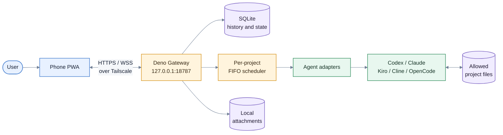

# KOAN Agent Gateway

KOAN is a private, single-user PWA for operating coding agents installed on your PC from a phone over Tailscale. The Deno Gateway serves the React SPA, stores normalized session history in SQLite, streams events over WebSocket, and launches each local agent in the selected project directory.

## Requirements

- Node.js 22.22 or newer
- pnpm 10 or newer
- Deno 2.9 or newer
- Tailscale on the PC and phone
- One or more installed CLIs: `codex`, `claude`, `kiro-cli`, `cline`, `opencode` or `opencode-cli`

## Start

```bash
pnpm install
pnpm run setup
pnpm build
pnpm start
```

`pnpm run setup` creates `.env.koan`. Edit `KOAN_ALLOWED_ROOTS` there before starting if your repositories are outside this directory. Separate multiple absolute roots with `:` on Linux/macOS. (`pnpm setup` without `run` is pnpm's own shell-setup command.)

The Gateway listens only on `127.0.0.1:18787`. Publish it inside your tailnet with:

```bash
tailscale serve --bg localhost:18787
```

Open the resulting `https://<machine>.<tailnet>.ts.net/` URL on the phone and enter the single-use 8-digit code printed by `pnpm start`. The cookie is Secure and therefore pairing through plain HTTP is intentionally unsupported in production.

On later starts, KOAN detects that Tailscale Serve route and prints a QR code. Scan it from a phone connected to the same tailnet; the pairing page opens with the one-time code already filled in. Set `KOAN_PUBLIC_URL` in `.env.koan` if the public URL cannot be detected automatically.

The normal `pnpm start` command never opens an interactive Deno permission prompt while the Gateway is running; access outside its configured permissions fails instead. To explicitly start the Gateway with every Deno permission granted, use `pnpm start:unrestricted`. This disables the Deno sandbox for the Gateway and expands the project picker to the filesystem root for that run. The picker still opens at the KOAN directory, from which you can move upward, browse sibling folders, and filter the current folder list. Hidden folders are not selectable.

For local UI development, use `pnpm dev`; the development Gateway allows an insecure localhost cookie and Vite proxies `/api` and `/ws`.

## Architecture



See [the detailed service architecture and request flow](docs/SERVICE_ARCHITECTURE.md) for Mermaid diagrams.

The frontend uses React Router Framework Mode with `ssr: false`. `app/routes.ts` contains only `flatRoutes()`; route filenames are the sole source for page nesting and URL paths.

The Gateway serializes turns per project (FIFO) while allowing separate projects to run concurrently. A browser disconnect does not stop an active turn. If the Gateway itself restarts, active turns are marked `interrupted` and are never replayed automatically.

## Security model

- Projects must resolve under an explicit allowed root; real paths are checked to prevent `..` and symlink escapes.
- Pairing codes expire after 10 minutes and can be used once. Device secrets are random 256-bit tokens; only SHA-256 hashes are stored.
- Mutations require a same-host Origin and an application CSRF header. WebSocket upgrades require the paired cookie and same-host Origin.
- The launcher grants Deno only loopback network access, selected filesystem roots, and named agent/Git/Claude SDK executables. Environment access remains enabled because agent SDKs must inherit existing proxy, credential-provider, shell, and locale variables.
- Coding agents are child processes and are **not** confined by Deno's permission sandbox. Their own sandbox and approval behavior remains important.
- Codex, Kiro, Cline, and OpenCode use their interactive protocols. Claude uses the official Agent SDK and routes `canUseTool` prompts through the same mobile approval sheet; read-only Claude tools are allowed automatically.

## Commands

```bash
pnpm dev          # Vite and Gateway with reload
pnpm build        # route typegen, SPA build, protocol and Deno checks
pnpm test         # unit/integration tests
pnpm test:e2e     # Playwright tests
pnpm test:agents  # explicit smoke probes for installed CLIs
pnpm start        # production host-native Gateway
```

Attachments are limited to 5 per turn. PNG/JPEG/WebP/GIF files may be up to 10 MiB; UTF-8 text, JSON, and XML files may be up to 2 MiB. Assets are stored locally under the configured KOAN data directory.
