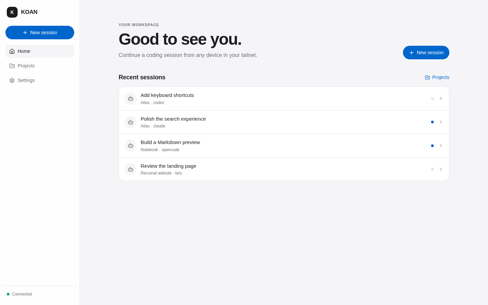
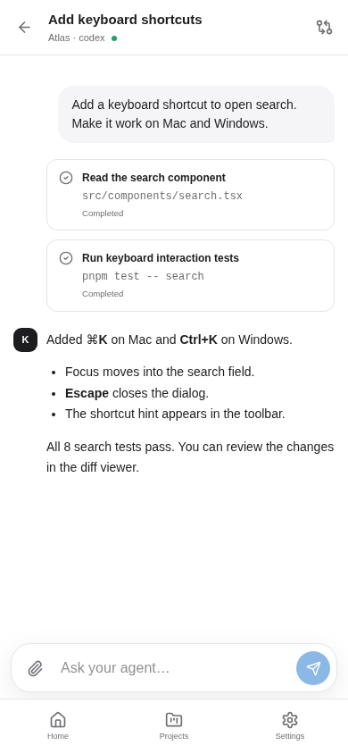
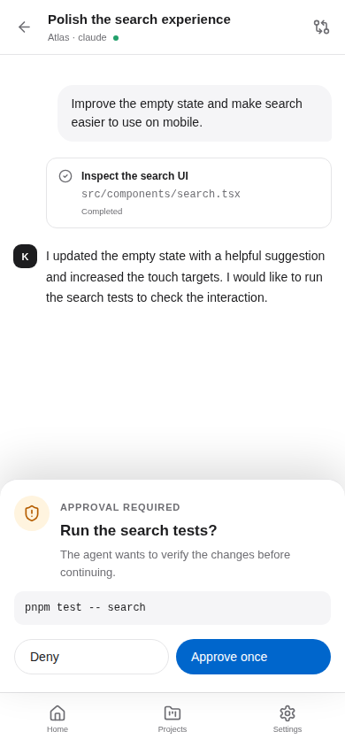
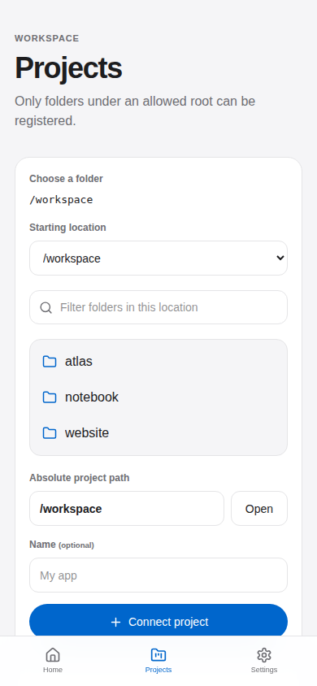
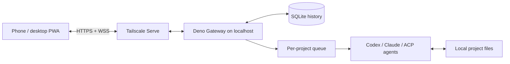

<div align="center">
  
  <h1>KOAN</h1>
  <p><strong>Your coding agents. Your computer. From your phone.</strong></p>
  <p>A self-hosted workspace for running local coding agents over Tailscale.</p>
  <p>
    <a href="https://github.com/0xkohe/KOAN/actions/workflows/ci.yml"></a>
    <a href="LICENSE"></a>
  </p>
  <p><a href="#quick-start">Quick start</a> · <a href="docs/USAGE.md">User guide</a> · <a href="docs/SERVICE_ARCHITECTURE.md">Architecture</a> · <a href="CONTRIBUTING.md">Contributing</a></p>
</div>

KOAN connects a mobile-friendly web app to the coding agents on your computer.
Start a task, follow its output, answer questions, approve commands, and inspect
Git changes from another device in your tailnet. Your repositories, session
history, and attachments stay on the host; agents still communicate with their
configured model providers.

**Early-stage software:** intended for one trusted user and their devices.
Agent compatibility depends on the installed CLI version and authentication.

## A look inside



<p align="center">
  
  &nbsp;
  
  &nbsp;
  
</p>

*Actual KOAN UI with fictional projects and mocked agent responses. These images
illustrate the interface, not a live provider run. [Reproduce the screenshots](docs/screenshots/README.md).*

## Features

- **One interface for several agents:** Codex, Claude, Kiro, Cline, and OpenCode adapters.
- **Built for your phone:** responsive chat, an installable PWA, QR pairing, and English/Japanese UI strings.
- **Stay in control:** command approvals, agent questions, cancellation, attachments, and a Git working-tree diff viewer.
- **Persistent sessions:** SQLite history and WebSocket event replay after reconnecting.
- **Project-aware scheduling:** turns run in order within a project; separate projects can work concurrently.
- **Self-hosted:** a Deno Gateway serves the app and launches agents directly in your local project folders.

## Quick start

### 1. Prepare your computer

Install:

| Requirement | Version / setup |
| --- | --- |
| [Node.js](https://nodejs.org/) | 22.22 or newer |
| [pnpm](https://pnpm.io/installation) | 10.27.0 (pinned in `package.json`) |
| [Deno](https://docs.deno.com/runtime/getting_started/installation/) | 2.9 or newer |
| [Tailscale](https://tailscale.com/download) | Computer and phone connected to the same tailnet |
| A coding agent | Installed and authenticated on the host; see the table below |

The commands below target Linux/macOS. Linux is exercised in CI. Use WSL2 on
Windows; native Windows has not been validated. Keep the host awake while tasks run.

### 2. Install and configure

```bash
git clone https://github.com/0xkohe/KOAN.git
cd KOAN
pnpm install --frozen-lockfile
pnpm run setup
```

Setup creates `.env.koan` and a private `.koan` data directory. Edit
`KOAN_ALLOWED_ROOTS` in `.env.koan` to include your project folders:

```dotenv
KOAN_ALLOWED_ROOTS=/absolute/path/to/projects
```

Use absolute paths without quotes or shell variables. Separate multiple roots
with `:` on Linux/macOS. The default is the KOAN checkout itself.
See [the configuration reference](docs/USAGE.md#configuration) and
[example environment file](.env.koan.example).

> Use `pnpm run setup`. `pnpm setup` is pnpm's own shell setup command.

### 3. Build and connect

Configure [Tailscale Serve](https://tailscale.com/docs/reference/tailscale-cli/serve)
to make the Gateway available over HTTPS within your tailnet:

```bash
pnpm build
tailscale serve --bg localhost:18787
pnpm start
```

Follow any HTTPS setup instructions printed by Tailscale. KOAN listens on
`127.0.0.1:18787` and detects the Serve URL. Scan the QR code printed by KOAN with
your phone, or open the Tailscale HTTPS URL and enter the eight-digit pairing code.
The code expires after ten minutes and works once. If automatic URL detection
fails, set `KOAN_PUBLIC_URL` in `.env.koan` and restart.

### 4. Start your first session

1. Open **Projects**, browse to a folder under an allowed root, and select **Connect project**.
2. Choose **New session**, select the project and an available agent, then start the session.
3. Send a task such as “Explain the structure of this repository.”
4. Follow the output and respond to any approval requests or questions.
5. Open **Working tree diff** in the session header to review changes.

Use your browser's install action or **Add to Home Screen** for an app-like
experience. KOAN must remain running on the computer. Closing the browser does
not stop a running turn; restarting the Gateway marks active turns as interrupted
and does not replay them automatically.

## Agent integrations

| Agent | Integration | Host setup |
| --- | --- | --- |
| Codex | `codex app-server` | `codex` on `PATH`, authenticated |
| Claude | Anthropic Agent SDK | SDK installed with KOAN; configure Claude authentication on the host |
| Kiro | ACP via `kiro-cli acp` | `kiro-cli` on `PATH`, authenticated |
| Cline | ACP via `cline --acp --auto-approve false` | `cline` on `PATH`, authenticated |
| OpenCode | ACP via `opencode acp` | `opencode` or `opencode-cli` on `PATH`, provider configured |

KOAN probes installed CLI versions at startup. The Claude SDK is listed as
available independently of authentication; a listed agent is not proof that its
credentials or protocol version will work. Model and mode choices come from the
adapter. Provider accounts, subscriptions, and API usage are separate from KOAN.

## How it works



The React SPA and API share the Gateway origin. The browser never launches an
agent directly. Read the [architecture guide](docs/SERVICE_ARCHITECTURE.md) for
request flow, persistence, and reconnect behavior.

## Security and privacy

Keep KOAN inside your trusted tailnet. Paired devices can operate your coding
agents. Allowed project roots constrain Gateway paths, but **agent subprocesses
run with the host user's access** and are not confined by Deno's sandbox. Use the
agents' own permission controls and review changes and approval requests.

Production pairing requires HTTPS. `pnpm dev` permits localhost HTTP for development.
History and attachments are stored locally without application-level encryption.
See [SECURITY.md](SECURITY.md) for the trust model and private vulnerability reporting.

## Development

```bash
pnpm dev          # Vite on :5173 + Gateway on :18787
pnpm lint         # TypeScript and Deno lint checks
pnpm test         # Unit and integration tests with fake agents
pnpm build        # Production SPA and protocol/Gateway checks
pnpm test:e2e     # Browser tests (install Playwright Chromium first)
pnpm test:agents  # Optional version probes of installed CLIs
```

See [CONTRIBUTING.md](CONTRIBUTING.md) for the development workflow and repository
layout, and the [user guide](docs/USAGE.md) for configuration and troubleshooting.

## License

[MIT](LICENSE) © 2026 0xkohe. Third-party agents and dependencies retain their own
licenses and terms. KOAN is an independent project.
