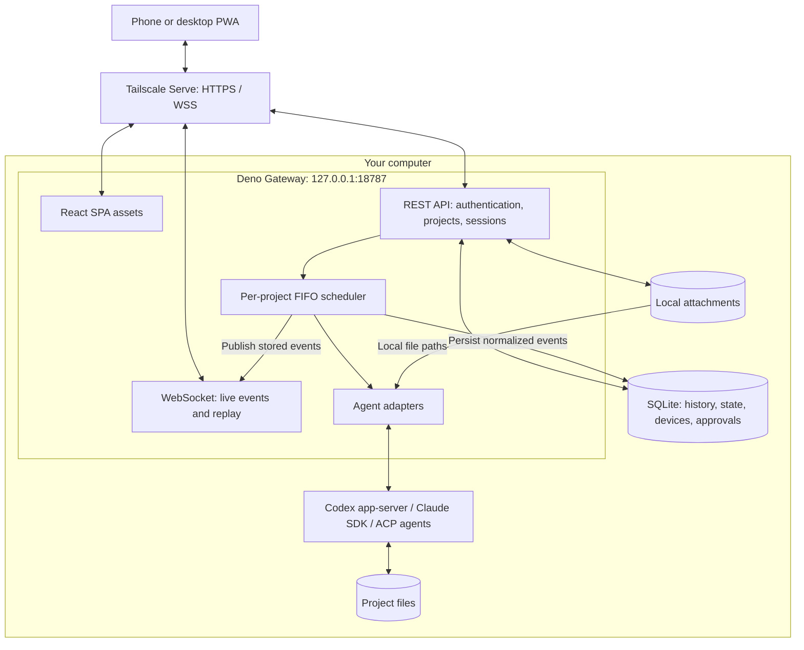

# KOAN architecture

KOAN is a single-user Gateway on the same computer as your repositories and coding
agents. Tailscale Serve provides the HTTPS entry point for your paired devices.
There is no separate KOAN cloud service. Agent processes can still contact their
configured model providers.

## Components



| Component | Implementation |
| --- | --- |
| Frontend | React, React Router Framework Mode (`ssr: false`), Vite, Tailwind CSS |
| Routing | `flatRoutes()` derives route nesting and URLs from filenames |
| Gateway | Deno HTTP server; REST API and WebSocket on the same origin |
| Persistence | SQLite plus attachment files under `KOAN_DATA_DIR` |
| Shared contracts | Zod schemas and TypeScript types in `packages/protocol` |
| Agent integration | Codex app-server, Anthropic Agent SDK, and ACP adapters |

## A turn from prompt to response

All API paths below are relative to `/api/v1`.

```mermaid
sequenceDiagram
    autonumber
    actor User
    participant PWA
    participant API as Gateway API
    participant Queue as Scheduler
    participant DB as SQLite
    participant Agent as Agent adapter / CLI
    participant WS as WebSocket

    User->>PWA: Send a prompt
    PWA->>API: POST /sessions/:id/turns + Idempotency-Key
    API->>Queue: Enqueue turn
    Queue->>DB: Persist user message and queued state
    Queue->>WS: Publish stored events
    Queue-->>API: turnId
    API-->>PWA: 202 Accepted
    WS-->>PWA: Queued / running events
    Note over Queue: FIFO within a project; parallel across projects
    Queue->>Agent: Run in the project directory

    loop Agent runs
        Agent->>Queue: Response delta, reasoning, or tool result
        Queue->>DB: Persist event with session sequence number
        Queue->>WS: Publish event
        WS-->>PWA: Update the timeline
    end

    opt Agent requests permission
        Agent->>Queue: Approval request
        Queue->>DB: Store pending approval
        Queue->>WS: approval.requested
        WS-->>PWA: Show approval sheet
        User->>PWA: Approve or deny
        PWA->>API: POST /approvals/:id/resolve
        API->>Queue: Resolve decision
        Queue-->>Agent: Continue or deny action
    end

    opt Agent asks a question
        Agent->>Queue: Question request
        Queue->>DB: Store pending question
        Queue->>WS: question.requested
        WS-->>PWA: Show question sheet
        User->>PWA: Answer
        PWA->>API: POST /questions/:id/resolve
        API->>Queue: Resolve answer
        Queue-->>Agent: Deliver answer
    end

    Agent-->>Queue: Turn completes
    Queue->>DB: Persist completion and final state
    Queue->>WS: turn.completed
    WS-->>PWA: Show completion
```

## Persistence and reconnects

Events have monotonically increasing sequence numbers within each session.
The browser keeps cursors and subscribes with them when the WebSocket reconnects.
The Gateway replays stored events; larger gaps use REST synchronization. The UI
bounds live event retention and can load earlier messages from persistent history.

A browser disconnect does not stop a turn. On a Gateway restart, active work is
marked interrupted, pending interactions are reconciled, and prompts are not
replayed automatically. Review the working tree before continuing interrupted work.

## Execution and trust boundaries

The scheduler serializes turns for a project, even across sessions. This reduces
concurrent edits from KOAN in the same folder, but does not coordinate external
editors or independently launched agents. The diff viewer shows the project's
working tree rather than attributing changes to a particular session.

The Gateway checks real paths against configured roots and validates API inputs.
Production authentication uses a secure device cookie, one-time pairing codes,
and Origin checks. The launcher scopes Deno's filesystem, network, and executable
permissions; environment access is enabled for agent integrations.

Agent subprocesses are outside Deno's permission sandbox. Their access depends on
the host account, agent sandbox, approval behavior, and configuration. Read the
[security model](../SECURITY.md) before deploying and the [user guide](USAGE.md)
for configuration and operations.
