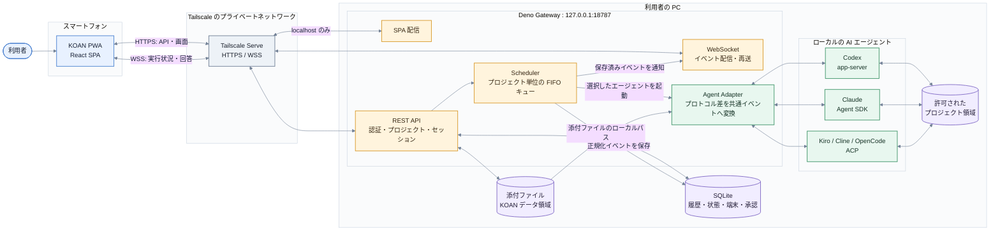
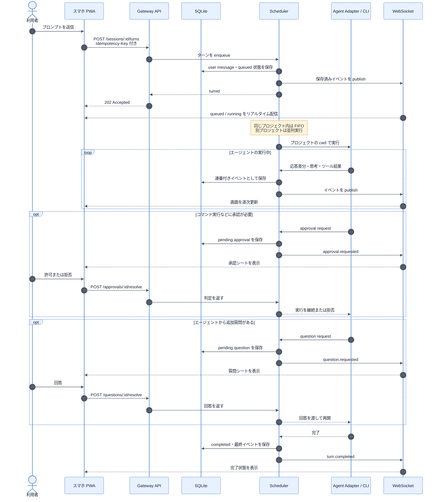

# KOAN サービス構成図

KOAN は、PC 上のコーディングエージェントをスマートフォンから操作するための、単一ユーザー向けローカルゲートウェイです。インターネット上に独立した KOAN サーバーを置くのではなく、PC 内の Gateway を Tailscale 経由で安全に公開します。

## 全体構成

## 1 回の依頼が処理される流れ

## 設計上の要点

- **PC 内で完結**: 会話履歴、添付ファイル、対象リポジトリ、エージェントプロセスは利用者の PC にあります。
- **外部から直接待ち受けない**: Gateway は `127.0.0.1:18787` のみに bind し、スマートフォンからは Tailscale Serve を経由します。
- **再接続に強い**: すべてのイベントにセッション内の連番を付けて SQLite に保存します。WebSocket 再接続時は端末側の cursor 以降を再送し、大きな欠落は REST API で再同期します。
- **実行順を制御**: 同じプロジェクトに対するターンは FIFO で直列化し、別プロジェクトのターンは並列に実行できます。ブラウザを閉じても実行は継続します。
- **エージェント差を吸収**: Codex、Claude、ACP 対応エージェントの出力を、メッセージ、ツール、承認、質問、差分などの共通イベントへ変換します。
- **認証と入力検証**: 初回は 10 分間有効な使い捨て 8 桁コードでペアリングし、以後は端末トークンの Secure Cookie を使います。更新 API には同一 Origin と CSRF ヘッダーも必要です。
- **ファイル境界**: 登録できるプロジェクトは明示した許可ルート配下だけです。real path を検証し、`..` やシンボリックリンクによる脱出を防ぎます。
- **サンドボックスの境界**: Gateway 自体には Deno の権限制限がありますが、子プロセスとして動くエージェントは Deno のサンドボックス外です。実際の変更権限は各エージェント側の sandbox・approval 設定でも制御します。
